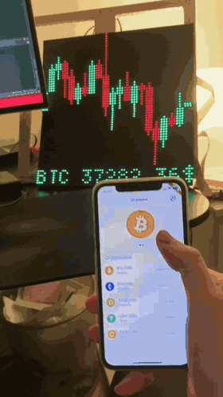
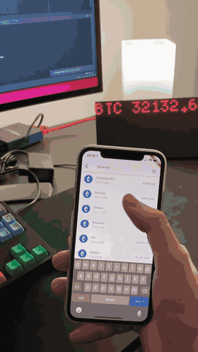

# Crypto Matrix

A Raspberry Pi powered RGB LED matrix that shows live cryptocurrency prices and
candlestick charts, configured from a companion app over Bluetooth LE.

- **Multi asset mode**: up to 8 markets, one per row, colored green or red
  depending on the direction of the last trade.
- **Single asset mode**: a candlestick chart of one market with its live price,
  rotating through the selected markets every 5 seconds.
- Setup (Wi-Fi credentials, markets, brightness, chart timeframe) happens in
  the app, no keyboard or screen needed on the Pi.

Market data comes from the public Binance API, no API key is required.

> **Project status**: Crypto Matrix ran on real hardware in 2021 and 2022. For
> open sourcing it, the code was updated to current toolchains and
> dependencies, but this updated version has not been run on a Raspberry Pi
> with LED panels again. Expect some rough edges, for example the Wi-Fi setup
> talks to wpa_supplicant directly, while current Raspberry Pi OS releases
> manage Wi-Fi with NetworkManager. Issues and pull requests are welcome.

## Real time, trade by trade

Most LED crypto tickers poll a price API every few seconds or minutes, so they
always show a snapshot that is already out of date. Crypto Matrix is event
driven from the exchange to the LEDs:

- **Streaming instead of polling**: the market data service keeps a WebSocket
  connection to the Binance trade stream of every selected market.
- **Every price change reaches the panels**: each trade that moves the price is
  pushed over gRPC to the display service and drawn immediately. There is no
  refresh interval anywhere in between.
- **Tick by tick colors**: a price turns green or red depending on whether the
  trade was higher or lower than the one before it, so you see the market move
  as it happens instead of a 24 hour change.

The candlestick charts are the one exception: they are loaded from the Binance
REST API and refreshed once per chart timeframe, as a candle only changes at
that interval anyway.

## Demo

<table>
  <tr>
    <td align="center" width="50%">
      <a href="docs/media/demo-2x2-panels.mp4"></a>
      <br>
      <b>Four panels (64×64)</b>: adding markets in the app, then switching to the candlestick charts
    </td>
    <td align="center" width="50%">
      <a href="docs/media/demo-2x1-panels.mp4"></a>
      <br>
      <b>Two panels (64×32)</b>: the same app with a wide two panel setup
    </td>
  </tr>
</table>

The previews are sped up, click them to watch the full videos.

## Architecture

```
 Phone (app/, Flutter)
        │  Bluetooth LE (JSON messages)
        ▼
 ┌────────────────────── Raspberry Pi ──────────────────────┐
 │  bluetooth ──gRPC──► wifi          (Wi-Fi scan/connect)  │
 │     │                                                    │
 │     ├──gRPC────────► market-data ◄── Binance WS + REST   │
 │     │                    │                               │
 │     └──gRPC────────► display (C++) ──► LED panels        │
 └──────────────────────────────────────────────────────────┘
   gRPC runs over Unix sockets in /run/crypto-matrix; messages are defined in proto/
```

| Directory | Language | Description |
|---|---|---|
| [`app/`](app) | Flutter | Companion app for iOS and Android. Finds the matrix over BLE, sends Wi-Fi credentials, manages markets and settings. |
| [`proto/`](proto) | Protobuf | Shared models and gRPC service definitions, plus the generated Go code. |
| [`services/display/`](services/display) | C++ | gRPC server (`/run/crypto-matrix/display.sock`) that renders text and candlestick charts on the panels using [rpi-rgb-led-matrix](https://github.com/hzeller/rpi-rgb-led-matrix). |
| [`services/market-data/`](services/market-data) | Go | Subscribes to Binance trade streams, polls candles, persists the selected markets and forwards everything to the display (`/run/crypto-matrix/market-data.sock`). |
| [`services/bluetooth/`](services/bluetooth) | Go | BLE GATT server (BlueZ) the app talks to. Translates app requests into calls to the other services. |
| [`services/wifi/`](services/wifi) | Go | Scans for and connects to Wi-Fi networks via wpa_supplicant (`/run/crypto-matrix/wifi.sock`). |
| [`deploy/systemd/`](deploy/systemd) | systemd | Unit files and installer that run the four services on boot. |

## Hardware

The display is configured in [`services/display/ledmatrix.cpp`](services/display/ledmatrix.cpp)
for 4 HUB75 panels (2 chained × 2 parallel) with `gpio_slowdown = 4`. With the
default 32×32 panels this gives a 64×64 pixel display with 8 text rows in the
5×8 font. Adjust the matrix options there for other panel layouts, for example
`parallel = 1` for the wide two panel setup from the demo (64×32 pixels, 4 text
rows).

## Installation on the Raspberry Pi

1. Disable the onboard audio of the Pi. It uses the same hardware as the LED
   matrix, and rpi-rgb-led-matrix refuses to start while it is enabled. Set
   `dtparam=audio=off` in `/boot/firmware/config.txt` (`/boot/config.txt`
   before Raspberry Pi OS Bookworm) and reboot.
2. Build and install [rpi-rgb-led-matrix](https://github.com/hzeller/rpi-rgb-led-matrix)
   and put `include/*` and `lib/*` into `/usr/local/include` and `/usr/local/lib`.
3. Install CMake and protobuf/gRPC for C++, the distribution packages are
   enough (`apt install cmake protobuf-compiler libprotobuf-dev libgrpc++-dev
   protobuf-compiler-grpc`). The C++ sources are generated from `proto/` at
   build time.
4. Install Go 1.27+ and BlueZ.
5. Clone this repository and install the systemd units:
   ```sh
   sudo deploy/systemd/install.sh
   ```
6. Build and start each service:
   ```sh
   services/display/install.sh
   services/market-data/install.sh
   services/wifi/install.sh
   services/bluetooth/install.sh
   ```

The services install to `/opt/crypto-matrix/<service>` and run as
`crypto-matrix-<service>.service`. Each Go service reads optional settings from
a `.env` file in its working directory, see the `.env.example` files.

Only the display service runs as root, as it needs access to the GPIO pins. The
other services run as the unprivileged `crypto-matrix` user, which the
installer creates. On top of that, the bluetooth service gets the
`CAP_NET_ADMIN` capability to configure the Bluetooth adapter, and the wifi
service the `netdev` group to talk to wpa_supplicant. The services communicate
over Unix sockets in `/run/crypto-matrix`, which only the `crypto-matrix` group
can access, and keep their state in `/var/lib/crypto-matrix`.

## Regenerating the protobuf code

```sh
proto/generate.sh
```

This regenerates the committed Go sources in `proto/gen/go` and needs `protoc`,
`protoc-gen-go` and `protoc-gen-go-grpc` on the `PATH`. The Go services
reference `proto/` through a `replace` directive in their `go.mod`, so changes
are picked up without publishing a new module version. The display service
generates its C++ sources itself when it is built.

## Credits

- [rpi-rgb-led-matrix](https://github.com/hzeller/rpi-rgb-led-matrix) by Henner Zeller
  for driving the panels, and the BDF fonts in `services/display/fonts`
  (see the license notes in that directory).
- Coin icons in `app/assets/coins` from
  [cryptocurrency-icons](https://github.com/spothq/cryptocurrency-icons) (CC0 1.0).

## License

The source code in this repository is licensed under the [MIT License](LICENSE).

The display service links against
[rpi-rgb-led-matrix](https://github.com/hzeller/rpi-rgb-led-matrix), which is
licensed under the GPL-2.0-or-later. A compiled `display` binary is therefore a
combined work that has to be distributed under the terms of the GPL.
